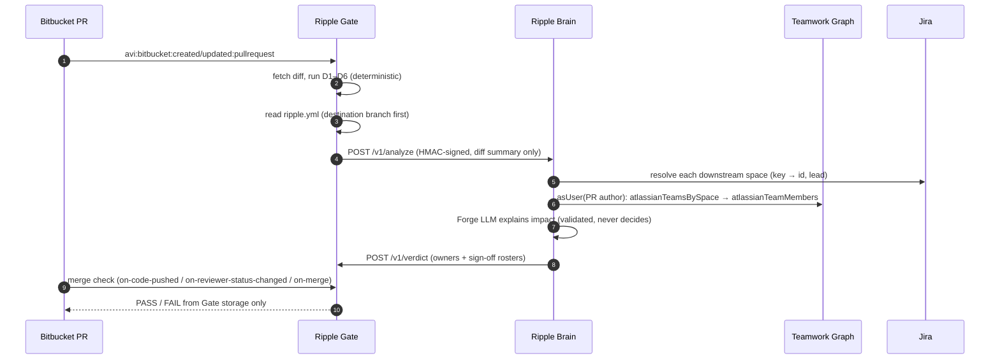

# Ripple — pre-merge blast radius & accountability gate

Ripple runs on Bitbucket Cloud pull requests and answers one question before merge:
**what else could this change break, who owns that, and have they signed off?**

When a PR touches a cross-cutting surface (a migration, an API contract, token handling…),
Ripple reads the repository's declared downstream Jira spaces, resolves who owns each one
through the **Atlassian Teamwork Graph**, and blocks the merge with a native Bitbucket
merge check until every owning team has signed off on the current commit — or the author
accepts the risk, which files a Jira ticket and leaves an audit trail.

Typo fixes, docs and tests pass silently: no panel noise, no cross-app traffic.

Built on Atlassian Forge for **Codegeist 2026** (Apps for Software Teams · Teamwork Graph).

> **For judge evaluation, use the pre-configured sandbox at one-atlas-hfre (Jira + Bitbucket) where downstream rosters and permissions are live.**

---

## How it works

Ripple is **two Forge apps** in one monorepo. Forge does not allow Bitbucket workspace
scopes and Jira / Teamwork Graph site scopes in the same manifest (`forge deploy` fails with
*"Workspace scopes can not be used with site scopes"*), so the work is split along that line:

| App | Installed on | Does | Scopes |
|---|---|---|---|
| **Ripple Gate** (`apps/gate`) | Bitbucket workspace | Diff classification (D1–D6), `ripple.yml` resolution, PR panel, merge check, gate state | `read:pullrequest:bitbucket`, `read:repository:bitbucket`, `storage:app` |
| **Ripple Brain** (`apps/brain`) | Jira site | Jira space lookup, Teamwork Graph ownership + rosters, Forge LLM narrative, sign-off eligibility, risk tickets | `read:graph:project:jira`, `read:graph:team:atlassian`, `read:graph:user:atlassian` (impersonation), `read:jira-work`, `write:jira-work`, `storage:app` |



### The deterministic core

- **The merge decision is a lookup table**, `MERGE_OUTCOME` in
  [`apps/gate/src/types.ts`](apps/gate/src/types.ts). It never reads LLM output.
- **The merge check reads Gate storage only.** It makes no call to Brain, so trigger lag
  or a slow LLM can delay analysis but can never let an unanalysed commit through: a
  missing record for the current head SHA is `ANALYSIS_PENDING` → FAIL.
- **Everything is keyed by the full 40-character head SHA.** A new push invalidates
  sign-offs and accepted risk for gating; the audit log is append-only.
- **The LLM only explains.** Forge LLMs (Claude, Atlassian-hosted) write the impact
  narrative; [`narrative.ts`](apps/brain/src/narrative.ts) drops any claim about a space
  Brain did not resolve. Nothing it says changes who must sign off.

| Gate state | Merge | Meaning |
|---|---|---|
| `NO_SENSITIVE_SURFACE` | PASS | No D1–D6 finding; nothing leaves Gate |
| `NOT_IN_CATALOG` | PASS | Sensitive diff, but the repo declares no `ripple.yml` (advisory) |
| `ANALYSIS_PENDING` | FAIL | Brain hasn't returned a verdict for this head SHA |
| `ANALYSIS_FAILED` | FAIL | Analysis failed after retries (fail-closed) |
| `SIGNOFF_REQUIRED` | FAIL | Downstream owners still have to sign |
| `CLEARED` | PASS | Every required space signed off on this commit |
| `RISK_ACCEPTED` | PASS | Author accepted risk; Jira ticket filed and linked |

## Detection rules (D1–D6)

Stage 1 runs in Gate with no network, no LLM and no randomness
([`noise-gate.ts`](apps/gate/src/noise-gate.ts)). Tests, fixtures, docs, lockfiles, images
and comment-only changes are ignored.

| Rule | Surface | Method | Severity |
|---|---|---|---|
| **D1** schema-migration | `migrations/`, `db/migrate/`, `alembic/versions/`, Flyway/Liquibase, `schema.prisma`, `*.sql` | path | HIGH |
| **D2** api-contract | OpenAPI/Swagger specs, `*.graphql`, `*.gql`, `*.proto`, `*.avsc`, `*.thrift` | path | HIGH |
| **D3** auth-token | `auth/`, `oauth/`, `session/`, `token/`, `jwt/`, `security/`, `identity/` … | path | HIGH |
| **D4** config-contract | `.env.example`/`.sample`/`.template`, `config/*.json\|yaml\|toml`, Helm `values*.yaml` | path | MEDIUM |
| **D5** shared-library | `shared/`, `common/`, `sdk/`, `contracts/`, `idl/`, package `index` entry points | path | MEDIUM |
| **D6a** destructive-sql | Added `DROP`, `TRUNCATE`, `RENAME`, `ALTER TABLE … DROP/RENAME/ALTER COLUMN` | content | CRITICAL |
| **D6b** contract-element-removed | OpenAPI path, protobuf rpc/field or GraphQL field removed and not re-added | content | CRITICAL |
| **D6c** token-shape | JWT sign/verify, claims, `expiresIn`, access/refresh tokens, audience/issuer, cookies, signing keys | content | HIGH |

One finding is kept per (file, surface), the most severe. Excerpts sent to Brain have
secret-looking assignments redacted.

## Teamwork Graph integration

Ripple uses the Teamwork Graph to answer *who owns this downstream space and who may
sign for it*. All calls are in [`apps/brain/src/forge/team-graph.ts`](apps/brain/src/forge/team-graph.ts).

- **User-only access, by design.** Teamwork Graph has no app-level access, so Brain's
  queue consumer calls `api.asUser(prAuthorAccountId).requestTeamworkGraph(query, variables)`.
  The graph scopes are declared with `allowImpersonation: true`, and ownership respects
  what the PR author is allowed to see.
- **Curated queries** (operation names follow the required `company_operation` form):

  | Operation | Curated query | Input | Used for |
  |---|---|---|---|
  | `ripple_teamsBySpace` | `atlassianTeamsBySpace` | space ARI `ari:cloud:jira:{cloudId}:project/{id}` | Teams that own a downstream Jira space |
  | `ripple_userInTeams` | `atlassianUserInTeams` | `ari:cloud:identity::user/{accountId}` | Fallback: the project lead's team |
  | `ripple_teamMembers` | `atlassianTeamMembers` | team ARI | The sign-off roster |

- **Tiered ownership** ([`ownership.ts`](apps/brain/src/ownership.ts)), deterministic:
  1. `SPACE_TEAM` — teams linked to the space in the graph
  2. `LEAD_TEAM` — no linked team → the Jira project lead's team (inferred)
  3. `LEAD_ONLY` — no team → the project lead alone
  4. `UNRESOLVED` — no lead either

  The roster is the project lead plus the owning teams' members. Because a missing graph
  scope returns *empty* data rather than an error, an empty roster is marked `DEGRADED`
  (unverifiable), never treated as "nobody owns this" and never as a silent pass.

## Dependencies as code: `ripple.yml`

Each service repository declares its Jira space and the spaces downstream of it, at the
repository root:

```yaml
service:
  id: auth-service
  jiraSpaceKey: PLAT
downstream: [MPLAT, MOB, SECOPS]
```

Gate reads it from the PR's **destination branch** first, so a PR cannot shrink its own
blast radius by editing the file. The PR head is used only when the destination has no
declaration yet. An invalid file fails closed.

## Sign-off and accept-risk rules

Enforced by Brain ([`decisions.ts`](apps/brain/src/decisions.ts)) and applied by Gate:

- The PR author can never sign off on any space, whatever roster they are on.
- A sign-off must come from the `VERIFIED` roster of a space that requires one. A
  `DEGRADED` roster accepts any non-author signer, and the sign-off is flagged as unverified.
- Risk may be accepted only by the PR author or the lead of the changed service's Jira
  space, with a justification. It always files a Jira ticket (idempotent: an existing
  ticket for the same PR and commit is reused) and the merge check then passes with the
  ticket visible.

## Security

- **Every inter-app request is signed** with HMAC-SHA256
  ([`packages/contracts/src/signing.ts`](packages/contracts/src/signing.ts)): key id,
  timestamp (±5 min), nonce and signature headers (`x-ripple-*`). The shared secret is a
  Forge encrypted variable in both apps, with a previous key accepted during rotation.
- **Data minimisation:** only a diff summary (findings with short, redacted excerpts)
  crosses to Brain, never the raw diff.
- **Payloads are schema-decoded** on both sides ([`schemas.ts`](packages/contracts/src/schemas.ts)),
  and identifiers are branded types created only through `parse*` helpers.
- **Egress:** the only outbound call from either app is to the other app's Forge web
  trigger (`*.webtrigger.atlassian.app`). Everything runs on Atlassian infrastructure,
  but this app-to-app call counts as egress, so Ripple does not claim the *Runs on
  Atlassian* badge.

## Evaluating Ripple

The sandbox at **one-atlas-hfre** has both apps installed, the demo repository
`ripple-demo-service` with a `ripple.yml`, downstream Jira spaces with linked teams, and
"Ripple blast-radius gate" configured as a required merge check.

1. In Bitbucket workspace `one-atlas-hfre`, open a PR on `ripple-demo-service` that
   changes token handling (for example under `auth/`). The PR panel **Ripple — blast
   radius** shows the analysis as pending, and the merge check fails.
2. Within a minute or two the panel shows the downstream spaces, the owning teams, how
   ownership was resolved (`SPACE_TEAM` / `LEAD_TEAM` / `LEAD_ONLY`), who may sign, and
   the LLM impact narrative.
3. As a member of a downstream roster, click **Sign off**. Once every space has signed,
   the merge check passes.
4. Alternatively, as the PR author, choose **Accept risk** with a justification. A Jira
   ticket is created in the configured project and the merge check passes, showing the
   ticket key.
5. Push another commit: sign-offs reset for the new head SHA.
6. Negative control: a PR that only edits a README passes silently with no panel content.

**Limitations to keep in mind**

- Blocking requires the check to be marked **Required**, which is a Bitbucket Premium
  feature. On other plans the check runs and reports but does not block.
- Gate and Brain are paired per Forge environment through variables
  (`RIPPLE_BRAIN_API_URL`, `RIPPLE_GATE_API_URL`, `RIPPLE_SIGNING_KEY`). Installing the
  apps on a different site and workspace needs its own pairing, which is why the sandbox
  above is the recommended path.
- Teamwork Graph is in Preview, and newly linked teams can take a few minutes to appear.

## Repository layout

```
apps/gate/         Bitbucket workspace app (merge check, PR panel in Svelte 5, web trigger)
apps/brain/        Jira site app (web trigger, analysis queue consumer, Forge LLM)
packages/contracts Wire contract v1, schemas, branded ids, Result, HMAC signing
tests/             Cross-app contract tests
scripts/           Bundling, scope-boundary check, signed smoke request
```

Logic depends on the interfaces in `apps/*/src/ports.ts`; only `apps/*/src/forge/` imports
`@forge/*`, and tests use the fakes in `apps/*/src/testing/fakes.ts`.

## Development

Requires Node 24 for the toolchain and Node 22 (via nvm) for the Forge CLI.

```bash
npm install
npm run verify   # build contracts, typecheck, tests, no-any check, scope-boundary check, bundle
```

Deploy (Forge uploads `dist/` as-is, so always bundle first):

```bash
npm run bundle
cd apps/brain && npx forge deploy -e development --non-interactive
cd apps/gate && npx forge deploy -e development --non-interactive
```

Configure each environment with `forge variables set` (secrets with `--encrypt`):

| App | Variable | Value |
|---|---|---|
| Gate | `RIPPLE_BRAIN_API_URL` | Brain's web trigger URL (`forge webtrigger create` in `apps/brain`) |
| Brain | `RIPPLE_GATE_API_URL` | Gate's web trigger URL |
| both | `RIPPLE_SIGNING_KEY` | `{keyId}:{secret}`, same value in both apps, encrypted |
| both | `RIPPLE_SIGNING_KEY_PREVIOUS` | optional, the previous key during rotation |
| Brain | `RIPPLE_JIRA_PROJECT_KEY` | Jira project for accepted-risk tickets |
| Brain | `RIPPLE_JIRA_ISSUE_TYPE` | optional, defaults to `Task` |
| Brain | `RIPPLE_LLM_MODEL` | optional, defaults to the first active Forge LLM model |
| Brain | `RIPPLE_CLOUD_ID` | optional, site cloud id for space ARIs (falls back to the invocation context) |

After installing Gate, a workspace admin enables **Custom merge checks** and marks
**Ripple blast-radius gate** as Required.

## License

[MIT](LICENSE)
